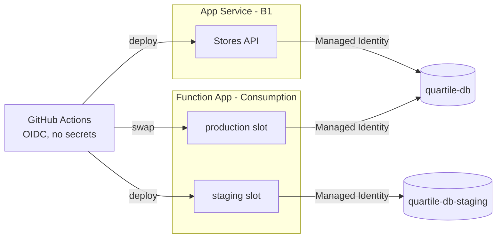

# Quartile - Backend Developer Assessment

Two small services for a globalized, multi-company retail scenario: a company has many stores, and each store has its own products.

| Assessment | Service | Folder | Hosting |
|---|---|---|---|
| Question 1 | **Stores API** - CRUD of companies and stores, built with TDD | [`stores/`](stores) | Azure App Service |
| Question 2 | **Products** - SQL Server objects + serverless CRUD | [`products/`](products) | Azure Functions (staging slot -> swap -> production) |
| - | **Postman collection** + environments | [`postman/`](postman) | - |

Both services are .NET 10 and share one Azure SQL database. Each one owns its own tables.

## Live environments

| | URL |
|---|---|
| Stores API (production) | https://app-quartile-stores-leo-f9cddyevaagcecbc.brazilsouth-01.azurewebsites.net/swagger |
| Products (production) | https://func-quartile-products-leo-g0dwffgxdkbvf3bj.brazilsouth-01.azurewebsites.net/api/swagger/index.html |
| Products (staging slot) | https://func-quartile-products--staging-b3eqgxdkhbgtfqha.brazilsouth-01.azurewebsites.net/api/swagger/index.html |

The API key was sent separately. Stores API expects it in the `X-Api-Key` header and the Functions in `x-functions-key`.

> The first request after some idle time can take a few seconds: the database is serverless (auto-pause) and the Functions run on the Consumption plan (cold start).

## Architecture



```
stores/                  Q1 - Stores.slnx
  src/Stores.Domain          entities and business rules, no dependencies
  src/Stores.Application     use cases + ports (repository interfaces)
  src/Stores.Infrastructure  EF Core adapter + migrations
  src/Stores.Api             controllers, API key auth, OpenAPI
  tests/                     unit (domain/application) and integration (WebApplicationFactory + LocalDB)
products/                Q2 - Products.slnx
  database/                  001 table, 002 scalar function (JSON), 003 insert procedure
  src/Products.Functions     Endpoints/, Application/, Domain/, Persistence/
  tests/                     unit (domain/application) and integration (real scripts + LocalDB)
postman/                 collection + production/staging environments
.github/workflows/       stores-api.yml, products-functions.yml, products-swap.yml
```

## Endpoints

**Stores API**

| Method | Route |
|---|---|
| GET / POST | `/api/companies` |
| GET / DELETE | `/api/companies/{companyId}` |
| GET / POST | `/api/companies/{companyId}/stores` |
| GET / PUT / DELETE | `/api/companies/{companyId}/stores/{storeId}` |
| GET | `/health` (anonymous liveness, doesn't touch the database) |
| GET | `/health/ready` (checks the database, needs the API key) |

**Products Functions**

| Method | Route | Uses |
|---|---|---|
| POST | `/api/products` | `dbo.InsertProduct` |
| GET | `/api/stores/{storeId}/products` | `dbo.GetProductsJson` (returned as is) |
| GET / PUT / DELETE | `/api/products/{id}` | EF Core |

Errors use ProblemDetails (`application/problem+json`) with a `code` field. `400` invalid input, `404` not found, `409` conflict.

## Database (Q2)

- **`dbo.Products`**: GUID key (`NEWSEQUENTIALID()`), `ProductCode` unique per store among active products, `Price DECIMAL(18,2)` in the store currency, UTC dates, `ROWVERSION`, named constraints.
- **`dbo.GetProductsJson(@StoreId)`**: scalar function returning `{ storeId, currencyCode, products: [...] }` built with `FOR JSON PATH`. `NULL` means the store doesn't exist or is inactive (404), `[]` means it has no products (200). It only lists products whose product, store and company are active. The `ORDER BY ProductCode` + `IsActive = 1` filter matches the filtered unique index, so it's an ordered seek with no sort.
- **`dbo.InsertProduct`**: a single `INSERT ... SELECT` from `Stores`. The currency is copied from the store (the client can't send one) and inactive stores/companies are filtered in the same statement, so it's atomic without an explicit transaction. Duplicated codes surface as error 2601 -> 409; unknown store -> `THROW 50001` -> 404.

## How to test

**Postman** - import the three files in [`postman/`](postman), fill `apiKey` / `functionsKey` in the environment and run the collection.
- `production`: run everything in order. It creates a company, a store and a product, checks the error cases (including the cross-service 409) and deletes what it created.
- `staging`: run only folders **2** and **4**; they use the store seeded in the staging database.

**Locally**
```bash
# Stores API (uses SQL Server LocalDB, see appsettings.Development.json)
dotnet test stores/Stores.slnx
dotnet run --project stores/src/Stores.Api

# Products (Azure Functions Core Tools; copy local.settings.example.json to local.settings.json)
dotnet test products/Products.slnx
cd products/src/Products.Functions && func start
```

**Integration tests need SQL Server LocalDB (Windows only).**
- Both services have them: the Stores API runs its migrations, and Products runs the real scripts from `database/` (001-003) over minimal `Companies`/`Stores` tables. Each run creates a throwaway database (`Quartile_Tests`, `Products_Tests`) and never touches Azure.
- LocalDB comes with Visual Studio (data storage workload) or the SQL Server Express installer ("LocalDB" option). Check it with `sqllocaldb info`; `MSSQLLocalDB` must be listed.
- On macOS/Linux, LocalDB doesn't exist, so the integration tests can't run there as they are. Unit tests run anywhere (`dotnet test` on the `*.UnitTests` projects).
- They always run in CI: both build jobs use `windows-latest`, which ships LocalDB, and a failing test blocks the deploy.

## Design decisions

**Hexagonal architecture in the Stores API.** It makes the business rules easy to test, reduces coupling and keeps the application easier to maintain, without adding unnecessary complexity. Domain has no dependencies; Infrastructure and Api are adapters.

**Result pattern instead of exceptions.** Expected business errors (store not found, invalid name) are returned as `Result` values instead of using exceptions as normal flow. Errors are explicit in the signatures and each error type maps straight to the right HTTP status. Exceptions are kept for unexpected situations.

**Soft delete.** Keeps history and traceability, and allows recovering records deleted by mistake. In a multi-company system it also keeps a reliable history of the stores. Name uniqueness only applies to active rows (filtered unique indexes).

**API key authentication.** Chosen for simplicity: the scope doesn't need user authentication or complex authorization, and it's a direct way to protect an API consumed by another system. Keys are compared in constant time. If I needed per-user identity, fine-grained permissions or expiring tokens, I'd go with JWT / OAuth 2.0. The Functions use the native function keys for the same reason.

**Deployment.**
- *GitHub Actions* automate build, tests and deploy, so the process is reproducible and less error prone. A failing test (unit or integration) blocks the deploy. Azure login uses OIDC with a federated credential, so there are no secrets in GitHub.
- *Managed Identity* lets the apps reach Azure SQL without storing credentials. Each app's database user only has read/write on data (plus `EXECUTE` on the two Q2 objects for the Function), no schema permissions.
- *Migrations run outside the app* to keep control over database changes, avoid several instances applying them at the same time, and separate the API deploy from schema changes.

**Currency rule across services: composite FK.** A store's currency can't change while it has products. `Products(StoreId, CurrencyCode)` references `Stores(Id, CurrencyCode)`, so SQL Server rejects the update and the Stores API maps the FK violation to `409`. I discarded an HTTP call from the API to the Function: it would add runtime coupling (no store could be edited with the Function down), and check-then-update isn't atomic, so a product could be created in between. The constraint is atomic and the Stores API doesn't need to know the Products service. The shared database is an accepted, explicit coupling: the constraint is the contract.

**Lean Products service.** The Function has a smaller and more specific scope, so a single project with well organized folders gives simplicity without losing separation of concerns. I avoided the extra complexity of several projects while it didn't bring a proportional benefit. It doesn't reference the Stores code; small types like `Result` are duplicated on purpose.

**Staging slot with its own database.** The Function deploys only to the `staging` slot; a one-click workflow swaps it to production (and swapping again is the rollback). Staging has a separate database so migrations, schema changes and app behavior can be tested in a production-like environment without putting real data at risk. The connection string is a slot setting, and each database only has a user for its own slot identity, so isolation is enforced by permissions and not only by configuration.

## Trade-offs and known limitations

- `Price DECIMAL(18,2)`: currencies with 3 decimals (KWD, BHD) would need `DECIMAL(19,4)`.
- No time zone per store; everything is stored in UTC.
- Products and stores share one database (accepted coupling, see above).
- The Azure Functions host storage and Azure Files use storage keys: on the Consumption plan the content share doesn't support identity-based connections.
- Public endpoint with firewall rules on SQL; no VNet / private endpoints, no Defender (cost and scope).
- Only the Function has a staging environment (the assessment asks for it there). Slots for the API would need the Standard tier.
- Pull requests don't run CI yet; tests run on merge to `main` and block the deploy.

## What I'd do next

- Azure API Management in front of both services (single gateway, subscription keys, rate limiting).
- `PATCH` with JSON Merge Patch for partial updates.
- Integration tests against SQL Server in a container (Testcontainers) instead of LocalDB: same engine as Azure SQL, runs on any OS with Docker, and CI could go back to Linux runners.
- CI on pull requests, and a staging slot for the Stores API.
- **Separate databases per service.** Today the composite FK is the contract between the services. With one database each:
  - The Stores API would publish `StoreCreated` / `StoreUpdated` / `StoreDeactivated` to an Azure Service Bus topic, using a transactional **outbox** so an event is never lost if the app fails right after saving.
  - The Products Function would consume them (Service Bus trigger) and keep a local **store replica** (`Id`, `CompanyId`, `CurrencyCode`, `IsActive`). Creating a product would validate against that replica, with no call to the Stores API, so it keeps working if the API is down.
  - Consumers must be idempotent, and events ordered per store (Service Bus sessions keyed by `StoreId`).
  - Trade-off: eventual consistency. A product created right after its store may get a 404 until the event arrives.
  - The currency rule can't be an FK anymore: either the Stores API keeps an eventual product count per store (from `ProductCreated` / `ProductDeleted` events), or the currency becomes immutable after creation, which is the simplest option.
